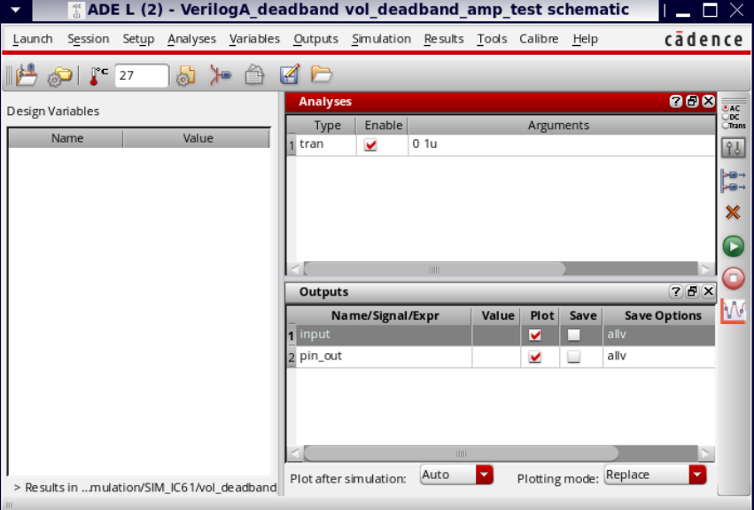
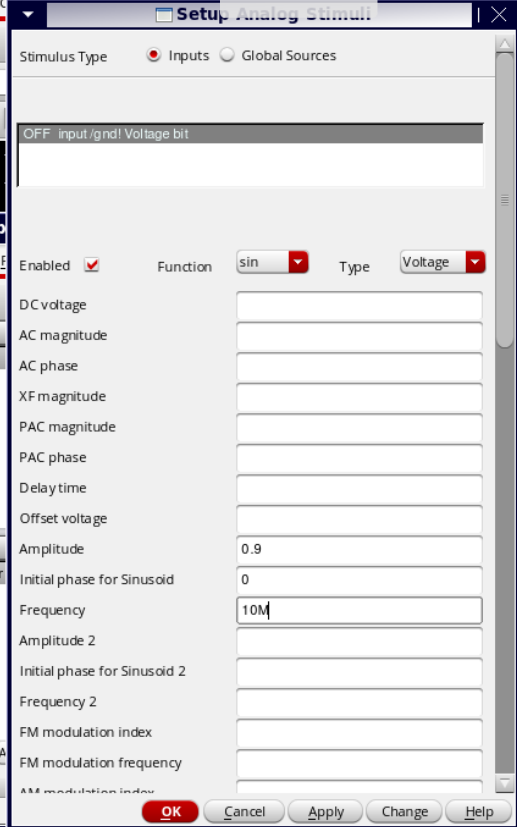
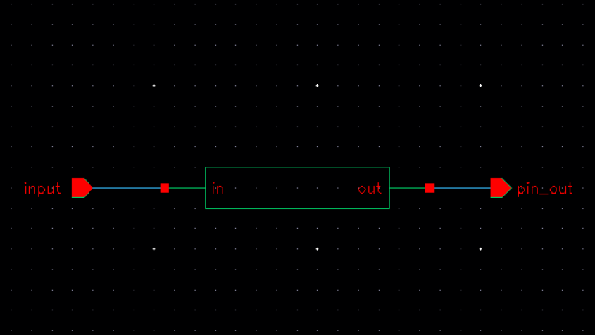
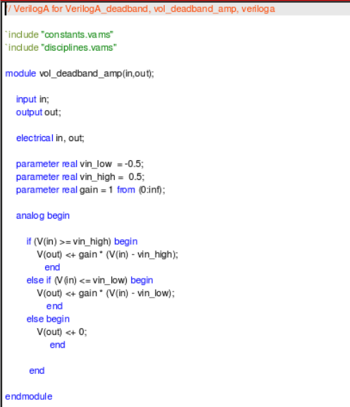
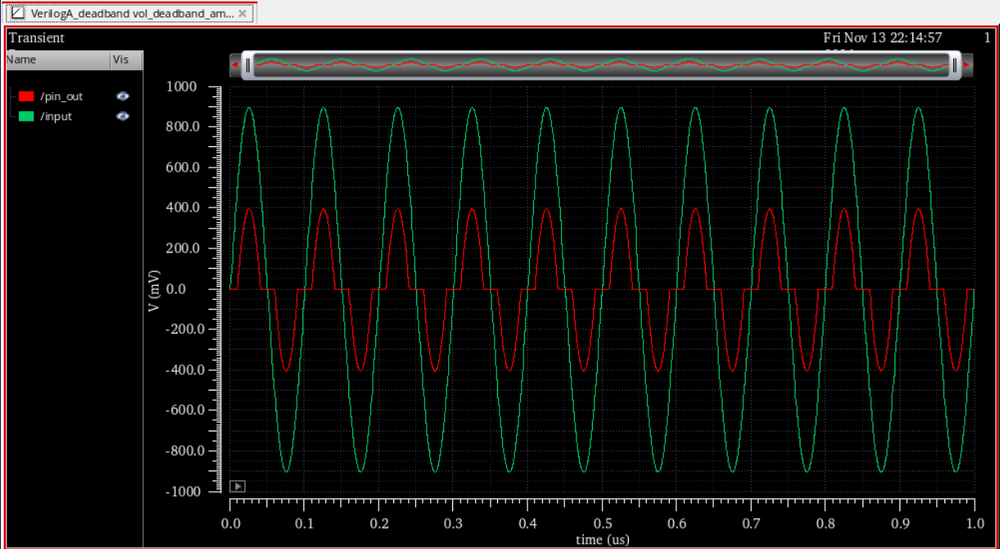
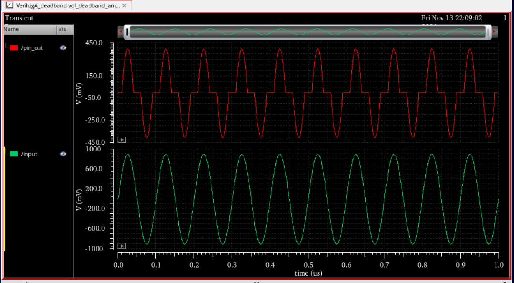

# Verilog-A Deadband Amplifier Design and Transient Simulation

## Overview

This project implements and simulates a **Deadband Amplifier using Verilog-A in Cadence Virtuoso**. The amplifier is designed to produce an output only when the input voltage exceeds a predefined threshold range. Within the deadband region, the output remains at zero.

The behavioral model is developed using Verilog-A and verified through transient analysis in Cadence ADE L. A sinusoidal input signal is applied to evaluate the amplifier's response across positive, negative, and deadband regions.

## Project Objectives

- Develop a behavioral deadband amplifier model using Verilog-A.
- Define configurable upper and lower threshold voltages.
- Implement a gain-controlled output response outside the deadband region.
- Perform transient simulation using Cadence Virtuoso ADE L.
- Analyze the relationship between input and output waveforms.

## Design Specifications

| Parameter | Value |
|---|---|
| Design | Deadband Amplifier |
| Modeling Language | Verilog-A |
| EDA Tool | Cadence Virtuoso |
| Simulation Environment | Cadence ADE L |
| Analysis Type | Transient Analysis |
| Upper Threshold | +0.5 V |
| Lower Threshold | −0.5 V |
| Gain | 1 |
| Input Signal | Sinusoidal |
| Input Amplitude | 0.9 V |
| Input Frequency | 10 MHz |
| Simulation Duration | 1 µs |

## Deadband Amplifier Operation

The amplifier operates according to three distinct regions:

1. **Positive Threshold Region:** When the input voltage exceeds the upper threshold, the output is proportional to the difference between the input and upper threshold.
2. **Deadband Region:** When the input voltage lies between the upper and lower thresholds, the output remains zero.
3. **Negative Threshold Region:** When the input voltage falls below the lower threshold, the output is proportional to the difference between the input and lower threshold.

The mathematical expression governing the output is:

\[
V_{out} =
\begin{cases}
A_v(V_{in}-V_{high}), & V_{in}\geq V_{high}\\
0, & V_{low}<V_{in}<V_{high}\\
A_v(V_{in}-V_{low}), & V_{in}\leq V_{low}
\end{cases}
\]

Where:

- \(V_{in}\) = Input voltage
- \(V_{out}\) = Output voltage
- \(V_{high}\) = Upper threshold voltage
- \(V_{low}\) = Lower threshold voltage
- \(A_v\) = Amplifier gain

## Verilog-A Implementation

The behavioral model is implemented using conditional statements inside an analog block.

```verilog
`include "constants.vams"
`include "disciplines.vams"

module vol_deadband_amp(in,out);

    input in;
    output out;

    electrical in, out;

    parameter real vin_low = -0.5;
    parameter real vin_high = 0.5;
    parameter real gain = 1 from (0:inf);

    analog begin

        if (V(in) >= vin_high) begin
            V(out) <+ gain * (V(in) - vin_high);
        end

        else if (V(in) <= vin_low) begin
            V(out) <+ gain * (V(in) - vin_low);
        end

        else begin
            V(out) <+ 0;
        end

    end

endmodule
```

## Design and Simulation

### 1. Cadence ADE L Simulation Setup

Transient analysis is configured in Cadence ADE L with a simulation duration of 1 µs. The input and output signals are selected for waveform visualization.



### 2. Input Signal Configuration

A sinusoidal voltage source is configured with an amplitude of 0.9 V and a frequency of 10 MHz. This input signal is used to evaluate the amplifier's response across the deadband thresholds.



### 3. Verilog-A Symbol Generation

The Verilog-A module is represented using a symbol with input and output terminals, allowing it to be instantiated within a test schematic.



### 4. Testbench Symbol

The generated symbol is incorporated into the testbench schematic for transient simulation.


### 5. Verilog-A Code

The behavioral model defines the upper and lower thresholds and applies the gain-controlled output response based on the instantaneous input voltage.



### 6. Transient Simulation Results

The transient simulation demonstrates the deadband amplifier's behavior. The output remains approximately zero when the input lies within the threshold range and responds proportionally when the input exceeds either threshold.





## Results and Observations

- The amplifier successfully demonstrates deadband behavior through a Verilog-A behavioral model.
- The output remains zero within the threshold range of −0.5 V to +0.5 V.
- For input voltages greater than +0.5 V, the output follows the positive threshold-referenced response.
- For input voltages less than −0.5 V, the output follows the negative threshold-referenced response.
- The output waveform exhibits clipped regions around zero corresponding to the deadband interval.
- Transient analysis validates the intended piecewise-linear input-output relationship.

## Applications

Deadband amplifiers and deadband control elements are commonly used in:

- Control systems to reduce unnecessary actuation.
- Noise suppression and threshold-based signal processing.
- Electronic instrumentation.
- Behavioral modeling and system-level analog simulation.
- Hysteresis-free threshold detection and signal conditioning.

*Note: This model implements a deadband without hysteresis. The upper and lower thresholds define a zero-output region.*

## Tools and Technologies

- Cadence Virtuoso
- Cadence ADE L
- Verilog-A
- Analog Behavioral Modeling
- Transient Simulation

## Conclusion

This project demonstrates the design and transient simulation of a Verilog-A deadband amplifier in Cadence Virtuoso. The behavioral model implements configurable threshold voltages and gain, producing a zero output within the deadband region and a proportional response outside it. The simulation results validate the intended functionality and provide practical experience with analog behavioral modeling and Cadence-based simulation workflows.
